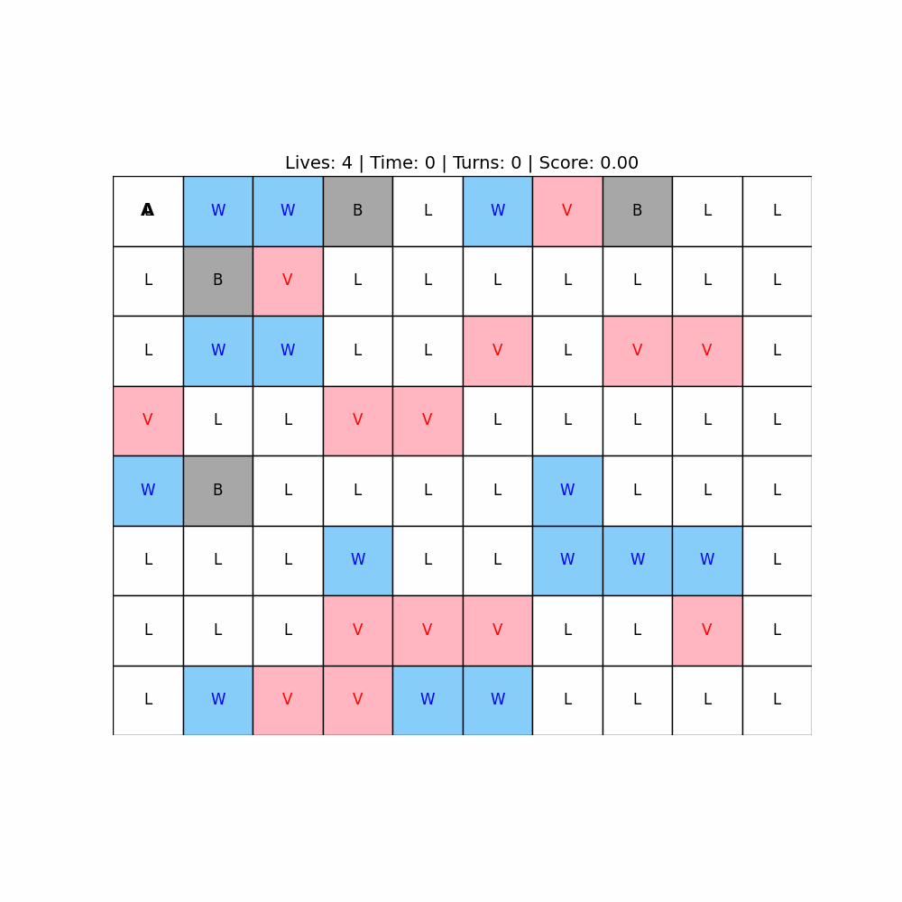
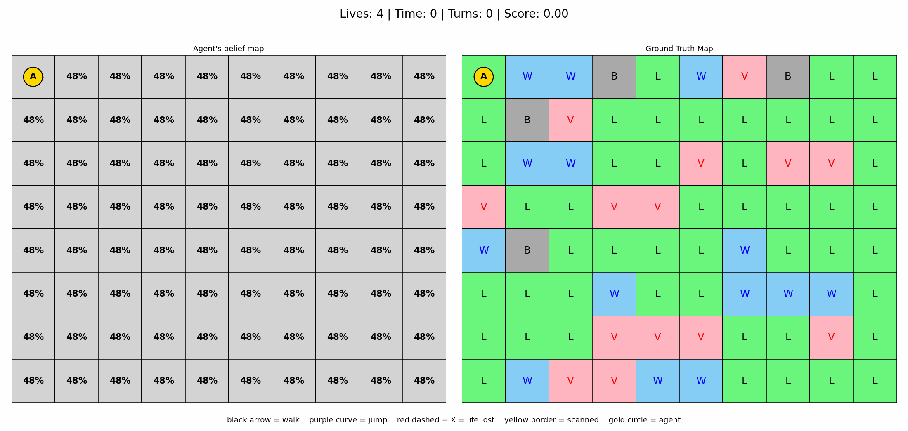

# Grid Navigation Agent: deterministic and Bayesian

An agent crosses an M x N grid from the start `(0, 0)` to the goal `(M-1, N-1)` and tries to minimise

```
score = (time + turns) / lives
```

while hazards try to take its lives. The project has two stages:

| | Exercise 1 | Exercise 2 |
|---|---|---|
| Agent knows the map | yes | no |
| Method | best-first (A*-like) search | Bayesian beliefs + sensor scans + replanning |
| Randomness | none | noisy thermal and seismic sensors |

**Live replays:** `docs/index.html` is a static viewer that plays back Exercise 2 runs step by step (see [Replay viewer](#replay-viewer)).




## The world

| Label | Meaning | Rules |
|---|---|---|
| L | Land | safe |
| V | Volcano | costs 1 life |
| W | Water | costs 1 life |
| B | Wall | impassable: cannot be entered or jumped over |

Movement: **walk** = 1 cell (time 2), **jump** = 2 cells in a straight line (time 3). Every move costs 1 turn. The agent starts with 4 lives and dies at 0. All costs live in `config.py` / `config2.py`.

## Exercise 1: deterministic agent

The grid is fully known. The generator draws a guaranteed safe route using anchor cells, with exactly 2 volcano and 2 water cells on the ground-truth path. A best-first search over `(row, col, lives)` finds the route that keeps the most lives first, then the lowest cost. It never crosses a wall.

## Exercise 2: Bayesian agent

The agent cannot see terrain. For each cell it keeps a belief `P(L), P(V), P(W), P(B)` and updates it from two noisy sensors:

| Terrain | P(thermal = true) | P(seismic = true) |
|---|---|---|
| Volcano | 0.85 | 0.60 |
| Water | 0.01 | 0.85 |
| Land | 0.10 | 0.05 |
| Wall | 0.05 | 0.01 |

`P(terrain | T, S)` is proportional to `P(T | terrain) x P(S | terrain) x prior`, normalised over the four terrain types. Priors are in `config2.py`. Stepping on a cell reveals it, and its belief collapses to the true type.

**How it decides**

- **Planning.** The search runs on the current beliefs. A step's risk is `P(V) + P(W)`, charged as an expected loss of lives, so uncertain cells look partly dangerous.
- **Scanning.** If a planned cell has `0.2 < risk < 0.7`, the agent scans it (1 turn, no time, no life lost), up to 4 times per cell. A cell that is still ambiguous afterwards is treated as blocked.
- **Probing.** If the planned step is very likely a hazard (`risk >= 0.7`), the agent first scans up to 2 times each other cell it could move to, then replans. Set `PROBE_ALTERNATIVES = False` in `config2.py` to turn this off.
- **Last-life guard.** On its final life it refuses steps that are likely to be fatal, widens its scan band, and detours around them. A hard turn limit (`MAX_TURNS`) stops runaway runs.
- **Walls.** Walking into a wall, or jumping over one, costs a turn and leaves the agent where it was. Its belief for that cell becomes "wall".

**Reading the belief map.** A cell labelled `B 64%` means "wall is the most likely type", not "certain wall". A quiet scan (T:0, S:0) looks the same for land and walls, so most cells labelled `B` are actually land. The `haz` figure under it is the real volcano-or-water risk.

**Measured results.** Over 120 to 150 generated grids the agent reaches the goal in about 95% of runs, with about 2.5 lives left on average. Numbers vary a little with the seed range, and walls being impassable makes the task harder than it was in the first version.

## Setup

```bash
python -m venv .venv
.venv\Scripts\activate          # Windows;  source .venv/bin/activate on macOS/Linux
pip install -r requirements.txt
```

Or with conda: `conda env create -f environment.yml`.

## Run

```bash
cd src/exercise1 && python main.py      # writes frames/ and simulation.gif
cd src/exercise2 && python main2.py     # writes frames2/ and simulation_ex2.gif
```

Both use `RANDOM_SEED` from their config file. Change it to get a different grid.

## Replay viewer

```bash
cd src/exercise2
python export_replay.py 1 30            # runs seeds 1..30 -> replays/*.json
```

Copy the `replays` folder into `docs/`, then:

```bash
cd docs
python -m http.server 8000              # open http://localhost:8000
```

The page has a seed picker, play/pause, step controls, a speed slider and keyboard shortcuts (space, left/right arrows). It shows the belief map next to the ground truth for every step.

## Project layout

```
src/exercise1/    agent.py, grid_gen.py, visualizer.py, config.py, main.py
src/exercise2/    agent2.py, grid_gen2.py, visualizer2.py, config2.py, main2.py, export_replay.py
docs/             static replay viewer (index.html), replays/, img/
```
